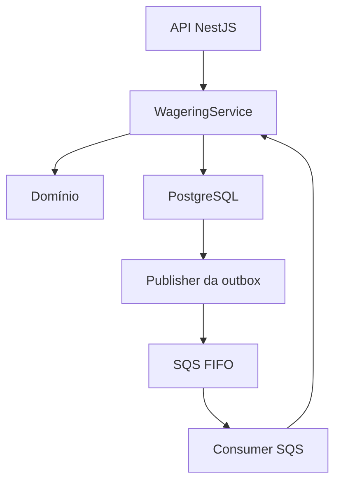

# Arquitetura e decisões

## Organização do código



O código está organizado em quatro áreas:

- `domain`: objetos de valor, entidades, eventos e regras de negócio, sem dependências de NestJS, TypeORM ou AWS.
- `application`: validação dos contratos e coordenação dos casos de uso.
- `infrastructure`: banco de dados, migrations, filas, workers, logs e métricas.
- `api`: adaptação das requisições HTTP para os casos de uso.

O `WageringService` coordena as operações financeiras e as transações SQL. O domínio concentra regras de dinheiro, movimentação de carteira e transições de estado.

## Entrada HTTP e publicação

1. A API valida a solicitação.
2. A aplicação verifica identidade da carteira, moeda e idempotência.
3. Uma transação SQL registra a operação como `PENDING` e grava `WagerTransactionRequested` na outbox.
4. A API retorna HTTP `202` após a persistência.
5. O publisher recupera mensagens pendentes da outbox e as envia ao SQS.
6. Após o envio, registra `published_at` na outbox.

A persistência da solicitação e da outbox ocorre no mesmo commit. Assim, uma solicitação aceita não depende de o SQS estar disponível naquele instante.

### Reserva da outbox

O publisher utiliza `FOR UPDATE SKIP LOCKED` para reservar lotes sem bloquear outros publishers.

A reserva possui prazo de validade em `locked_until`. Se o processo encerrar depois da reserva e antes da publicação, outro publisher poderá recuperar a mensagem quando esse prazo expirar.

O envio ao SQS e a atualização de `published_at` não pertencem a uma transação distribuída. Se o processo encerrar entre essas etapas, a mensagem poderá ser enviada novamente.

A deduplicação FIFO reduz duplicatas dentro da janela do SQS, enquanto inbox, idempotência e constraints do PostgreSQL protegem os efeitos financeiros de forma persistente.

## Consumo e confirmação

O consumer valida o envelope e executa o caso de uso dentro de uma transação SQL.

Nessa transação, a aplicação:

1. Localiza ou registra a operação pela identidade de negócio.
2. Registra a mensagem na inbox.
3. Bloqueia a transação e a carteira necessárias ao processamento.
4. Verifica referências, saldo e regras de negócio.
5. Persiste o resultado, os lançamentos do ledger e os eventos na outbox.
6. Confirma a transação SQL.

A mensagem é removida do SQS somente depois do commit.

Se o processo encerrar depois do commit e antes da remoção, a mensagem poderá ser entregue novamente. O processamento repetido não deve gerar outro efeito financeiro.

### Entrada direta pelo SQS

Uma solicitação recebida diretamente pelo SQS passa pelo mesmo caso de uso da aplicação.

O `messageId` do envelope pode ser diferente do identificador interno da transação financeira.

O registro da operação, a inbox e os efeitos financeiros são coordenados na mesma transação SQL. Esse caminho não cria outra solicitação `WagerTransactionRequested` na outbox, evitando um ciclo de republicação.

## Filas

Os nomes padrão utilizados pela aplicação são:

| Fila | Responsabilidade |
|---|---|
| `wager-transactions.fifo` | Solicitações de processamento |
| `wager-transactions-dlq.fifo` | Mensagens encaminhadas após falhas repetidas |
| `wager-events.fifo` | Eventos de integração publicados pela outbox |

O publisher utiliza o identificador do agregado como `MessageGroupId` e o identificador da linha da outbox como `MessageDeduplicationId`.

A ordenação FIFO vale dentro de cada grupo. Ela não representa uma ordenação global por carteira para todas as solicitações.

A serialização das movimentações de uma carteira é garantida pelo lock no PostgreSQL.

O projeto publica eventos de integração, mas não inclui consumidores downstream para esses eventos.

## Concorrência e idempotência

O processamento utiliza `SELECT ... FOR UPDATE` na carteira. Operações sobre a mesma carteira são serializadas, enquanto carteiras diferentes podem ser processadas em paralelo.

O isolamento utilizado é `READ COMMITTED`. As garantias financeiras dependem também dos locks explícitos e das constraints do banco.

As restrições persistentes incluem:

- Carteira única por jogador e moeda.
- Transação única por provedor e identificador externo.
- Chave de idempotência única por provedor.
- Inbox única por consumidor e identificador de mensagem.
- Lançamento financeiro único por transação.

O hash de negócio utiliza SHA-256 sobre JSON canônico, com chaves ordenadas. A chave de idempotência e os metadados de transporte não fazem parte desse hash.

Uma repetição com a mesma identidade e o mesmo conteúdo retorna a operação existente. Conteúdo de negócio diferente para uma identidade já utilizada gera conflito.

A inbox também verifica a consistência do conteúdo associado ao identificador da mensagem.

Transações terminais não são movimentadas financeiramente novamente.

## Dinheiro, saldo e ledger

Os valores monetários são recebidos como strings decimais e convertidos diretamente para `decimal.js`.

Os cálculos monetários não utilizam `number`. As respostas serializam os valores com duas casas decimais.

O PostgreSQL armazena os valores em `NUMERIC(20,2)`. As validações de domínio e as constraints do banco protegem os limites e as invariantes financeiras.

| Operação | Efeito |
|---|---|
| `BET` | Débito na carteira |
| `WIN` | Crédito na carteira |
| `LOSS` | Registro da operação, sem movimentação financeira |
| `REFUND` | Crédito que reverte uma aposta elegível |
| `ROLLBACK` | Movimentação inversa à operação referenciada |

Uma abertura com saldo positivo cria a transação interna `OPENING` e um crédito no ledger, no mesmo commit da criação da carteira.

Uma carteira aberta com saldo zero não recebe um lançamento artificial.

O ledger mantém o histórico financeiro e possui proteção contra alteração e exclusão dos lançamentos.

### Reconciliação

A reconciliação compara o saldo armazenado na carteira com a soma dos créditos e débitos do ledger.

A resposta informa:

- Saldo armazenado.
- Saldo calculado.
- Diferença.
- Consistência.
- Quantidade de lançamentos verificados.

Uma divergência é retornada e medida. A reconciliação não altera o saldo silenciosamente.

## Referências fora de ordem e reversões

Operações que dependem de uma referência ainda indisponível podem permanecer em `PENDING_REFERENCE`.

Isso significa que a operação referenciada ainda não foi localizada ou não está pronta para permitir o processamento. A ausência de um campo obrigatório no contrato continua sendo um erro de validação.

Um worker recupera operações pendentes e tenta processá-las novamente com backoff exponencial.

Os valores padrão são dez tentativas e intervalo limitado a 60 segundos, configuráveis por variáveis de ambiente.

As referências são verificadas quanto a provedor, jogador, carteira, rodada, moeda, tipo e estado da operação.

Para reversões:

- `REFUND` referencia uma operação `BET`.
- `ROLLBACK` referencia uma operação `BET`, `WIN` ou `REFUND`.
- O valor deve corresponder ao da operação referenciada.
- Locks e constraints impedem reversões duplicadas conforme as regras implementadas.
- Uma reversão que causaria saldo negativo é rejeitada com `REVERSAL_INSUFFICIENT_FUNDS`.

## Estados das transações

| Estado | Significado |
|---|---|
| `PENDING` | Solicitação persistida e aguardando processamento |
| `PENDING_REFERENCE` | Processamento aguardando uma referência |
| `PROCESSED` | Operação concluída |
| `REJECTED` | Operação rejeitada por regra de negócio |
| `FAILED` | Falha registrada após esgotamento das tentativas de infraestrutura |

`PROCESSED`, `REJECTED` e `FAILED` são estados terminais.

As transições são verificadas pelo domínio. Rejeições e falhas possuem códigos estáveis para consulta e auditoria.

## Retry e DLQ

Falhas de infraestrutura durante o consumo deixam a mensagem sem confirmação de remoção. Após o vencimento da visibilidade, ela pode ser entregue novamente.

A fila de solicitações possui uma política de redrive com `maxReceiveCount=5`, que encaminha mensagens para a DLQ após repetidas entregas sem conclusão.

O auditor da DLQ:

1. Valida o envelope.
2. Registra a auditoria de forma idempotente.
3. Localiza ou registra a operação correspondente.
4. Marca operações ainda não terminais como `FAILED`, com o código `INFRASTRUCTURE_RETRIES_EXHAUSTED`.
5. Grava o evento de falha na outbox.
6. Remove a entrega da DLQ somente depois do commit.

Operações já terminais preservam seu resultado.

Mensagens malformadas são registradas nos logs e preservadas na DLQ para inspeção, sujeitas à retenção da fila.

Falhas na auditoria também mantêm a mensagem disponível para uma tentativa posterior, após o vencimento da visibilidade.

## Migrations e persistência

O projeto utiliza migrations versionadas do TypeORM.

Os casos financeiros executam SQL parametrizado por meio de `QueryRunner`, permitindo controlar explicitamente:

- Transações.
- Locks pessimistas.
- Reserva de lotes com `SKIP LOCKED`.
- Constraints.
- Inserções com `ON CONFLICT`.

O domínio não depende de tipos ou decorators do ORM.

Um advisory lock serializa a execução das migrations quando múltiplas instâncias iniciam simultaneamente.

Saldo, ledger, estado da operação, inbox e eventos envolvidos no processamento são persistidos dentro da mesma transação SQL. Uma falha de persistência provoca rollback.

## Disponibilidade e decisões técnicas

- A entrega é tratada como at-least-once. Podem existir mensagens duplicadas, e as proteções persistentes impedem efeitos financeiros duplicados.
- Não existe transação distribuída entre PostgreSQL e SQS.
- Uma solicitação nova só é aceita depois da persistência no PostgreSQL.
- A indisponibilidade do SQS mantém mensagens pendentes na outbox para publicação posterior.
- A readiness verifica dependências, mas não garante que todas as mensagens estejam sendo processadas ou que as filas estejam vazias.
- Falhas de negócio produzem resultados auditáveis, sem movimentações parciais.
- Os exemplos locais utilizam `BRL`; o objeto de valor `Money` também contempla `USD` e `EUR`.
- Autenticação não está implementada. `ProviderIdentityPort` define um ponto de integração para uma implementação futura.
- As filas são tratadas como canais internos confiáveis no ambiente apresentado.
- O caso de uso concentra a coordenação SQL no `WageringService`. A persistência não está totalmente abstraída por interfaces de repositório.
- Inbox e outbox são persistidas em tabelas e manipuladas pela aplicação e pelos workers.

## Observabilidade

A aplicação fornece logs estruturados em JSON e métricas no endpoint `/metrics`.

A instrumentação inclui contadores e medições para processamento, duplicatas, novas tentativas, latência, atraso da outbox, reconciliação e tamanho da DLQ.

Os endpoints `/health/live` e `/health/ready` permitem verificar a execução da aplicação e a disponibilidade das dependências.

O projeto não inclui dashboards nem instrumentação distribuída com OpenTelemetry.

## Testes

| Arquivo | Cobertura principal |
|---|---|
| `test/unit.test.ts` | Money, Wallet, WagerTransaction e dependência do serviço no worker |
| `test/integration.test.ts` | PostgreSQL, migrations, idempotência, concorrência, operações financeiras, referências, reconciliação e atomicidade |
| `test/system.test.ts` | Três processos worker, recuperação da outbox, entrada direta por SQS, auditoria da DLQ e reentrega após commit sem confirmação |
| `test/retry-dlq.test.ts` | Falhas de processamento, novas tentativas e encaminhamento automático para a DLQ |

Execute todas as etapas sequencialmente:

```powershell
bun run test:all
```

Os testes com infraestrutura utilizam o banco `jungle_test` e filas separadas das filas da aplicação.

Esses testes limpam suas tabelas e não devem ser executados simultaneamente contra os mesmos recursos.

Não configure `.env.test` para o banco de desenvolvimento.

## Ambiente local

O Compose utiliza PostgreSQL e LocalStack com `SQS_ENDPOINT_STRATEGY=path`.

A aplicação dentro do Compose utiliza:

- PostgreSQL: `postgres:5432`.
- Endpoint SQS: `http://localstack:4566`.

A aplicação e os testes executados diretamente no Windows utilizam:

- PostgreSQL: `localhost:5432`.
- Endpoint SQS: `http://localhost:4566`.

As URLs das filas são obtidas pelo SDK durante a inicialização, utilizando `CreateQueue` e `GetQueueUrl`.

Consulte [README.md](README.md) para os comandos de instalação, execução e testes.